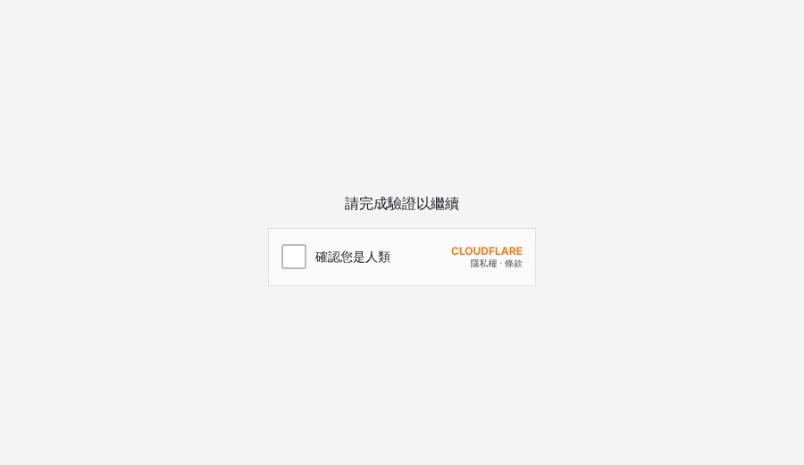
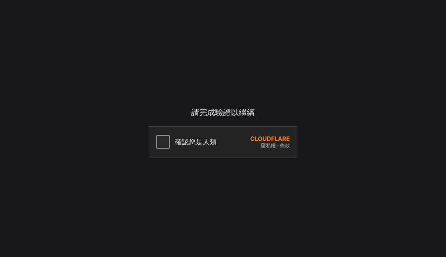

# turnstile-gate

[](https://github.com/OWNER/turnstile-gate/actions/workflows/build.yml)

一支單檔、零相依的 Go 反向代理，在自架服務前面加一道 **Cloudflare Turnstile** 驗證。
沒通過驗證的請求碰不到後面的服務；通過後發一張簽章 cookie，之後直接放行。

適合用來保護**你改不了程式碼的 Web 介面**——例如 Synology DSM、QNAP QTS、路由器管理頁、各種自架服務的登入頁——而且**不需要讓流量經過 Cloudflare 代理或 Tunnel**。

<p align="center">
  
  
</p>

## 特色

- **輕量**：單一靜態執行檔約 8 MB，`scratch` 映像，記憶體十幾 MB，只用 Go 標準函式庫
- **不必經過 Cloudflare**：Turnstile 只負責判斷「是不是人」，你的流量不經過 Cloudflare
- **可跑在路由器上**：提供 `amd64`、`arm64`、`arm/v7` 映像，附 MikroTik RouterOS v7 container 部署範例
- **HTTPS 自帶**：讀取匯入的 PEM 憑證，檔案更新後自動重新載入，不必重啟
- **安全預設**：伺服器端 `siteverify` 驗證、HMAC 簽章 cookie、驗證 token 網域、防 open redirect、不轉送閘門 cookie 給後端

## 運作原理

```
                     ┌────────────── Cloudflare（只做人機判斷）──────────────┐
                     │                                                       │
                ② 瀏覽器內執行 challenge，取得 token          ④ siteverify（伺服器對伺服器）
                     │                                                       │
瀏覽器 ──① HTTPS──→ turnstile-gate ──────────⑤ 通過才轉發─────────→ 後端服務（DSM 等）
        ←─ 驗證頁 ──     │  ③ 送出 token                                   （不對外開放）
                         └─ 發 HMAC 簽章 cookie，有效期內直接放行
```

1. 瀏覽器連進來，沒有有效 cookie → 導向 `/__gate` 驗證頁
2. 頁面上的 Turnstile 元件在瀏覽器內跟 Cloudflare 溝通，判定是人就給一張一次性 token
3. 瀏覽器把 token 送到 `/__gate/verify`
4. 閘門用 Secret Key 向 Cloudflare 驗證 token（並確認 token 是在本網域產生）
5. 通過 → 發 `__gate` cookie（`HttpOnly`、`Secure`、`SameSite=Lax`，HMAC-SHA256 簽章）→ 轉發到後端

非瀏覽器請求（XHR、API）沒有 cookie 時直接回 `401`，不會收到 HTML。

> **它擋的是 bot，不是人。** 真人點一下就能通過，帳號安全仍要靠後端服務自己的密碼與 2FA。詳見 [安全模型](docs/security.md)。

## 快速開始

### 1. 建立 Turnstile 金鑰

Cloudflare 後台 → **Turnstile** → **Add widget**，Hostname 填你要用的網域（不需要託管在 Cloudflare，DDNS 網域也可以）。記下 **Site Key** 與 **Secret Key**。

### 2. 執行

```bash
docker run -d --name turnstile-gate -p 8443:8443 \
  -v "$PWD/cert:/cert:ro" \
  -e TURNSTILE_SITEKEY=0x4AAAA... \
  -e TURNSTILE_SECRET=0x4AAAA... \
  -e GATE_KEY="$(openssl rand -hex 32)" \
  -e UPSTREAM=https://192.168.1.10:5001 \
  -e UPSTREAM_INSECURE=1 \
  -e CERT_FILE=/cert/fullchain.pem \
  -e KEY_FILE=/cert/privkey.pem \
  ghcr.io/OWNER/turnstile-gate:latest
```

### 3. 對外

路由器把 WAN `443` 轉發到這台的 `8443`，**後端服務本身的 port 不要對外**。打開 `https://你的網域/` 應該會先看到驗證頁。

> `GATE_KEY` 請固定保存；每次重啟都換的話，所有人的 cookie 都會失效。

## 設定

全部用環境變數。

| 變數 | 必填 | 預設 | 說明 |
|---|:-:|---|---|
| `TURNSTILE_SITEKEY` | ✅ | | Turnstile Site Key |
| `TURNSTILE_SECRET` | ✅ | | Turnstile Secret Key |
| `GATE_KEY` | ✅ | | 簽 cookie 用的密鑰，建議 `openssl rand -hex 32` |
| `UPSTREAM` | ✅ | | 後端位址，例：`https://192.168.1.10:5001` |
| `UPSTREAM_INSECURE` | | 關 | `1` = 不驗證後端憑證（後端為自簽憑證時） |
| `LISTEN` | | `:8443` | 監聽位址 |
| `CERT_FILE` / `KEY_FILE` | | | PEM 憑證與私鑰。兩者都設才啟用 HTTPS，否則以 HTTP 監聽 |
| `SESSION_HOURS` | | `12` | 通過驗證後 cookie 有效時數 |
| `BYPASS_PREFIXES` | | | 免驗證的路徑前綴，逗號分隔，例：`/webdav/` |
| `TRUST_CF_HEADER` | | 關 | `1` = 信任 `CF-Connecting-IP`。**只在 Cloudflare 代理或 Tunnel 後方開啟**，直接對外時此標頭可被偽造 |

### 端點

| 路徑 | 說明 |
|---|---|
| `GET /__gate` | 驗證頁 |
| `POST /__gate/verify` | 接收 token、呼叫 siteverify、發 cookie |
| 其他 | 有效 cookie → 轉發；否則瀏覽器導向驗證頁、其他請求回 `401` |

送往後端的請求會帶 `X-Real-IP`、`X-Forwarded-For`、`X-Forwarded-Proto`、`X-Forwarded-Host`；WebSocket 可正常轉發。

## 部署指南

- [MikroTik RouterOS v7 container](docs/deploy-mikrotik.md)：網路隔離、NAT、速率限制一次設定
- [從 Synology DSM 自動同步 Let's Encrypt 憑證](docs/cert-sync-dsm.md)
- 一般 Docker / NAS Container Manager：[`deploy/docker-compose.yml`](deploy/docker-compose.yml)

## 建置

```bash
# 本機
CGO_ENABLED=0 go build -ldflags="-s -w" -o turnstile-gate .

# 多架構映像
docker buildx build --platform linux/amd64,linux/arm64,linux/arm/v7 -t turnstile-gate .

# RouterOS 用的 tar
docker buildx build --platform linux/arm64 -o type=docker,dest=turnstile-gate-arm64.tar .
```

GitHub Actions 會在推送到 `main` 時發布 `ghcr.io/OWNER/turnstile-gate:latest`；推送 `v*` tag 時另外建立 Release，附上 `arm64`、`armv7`、`amd64` 三種 RouterOS 可直接匯入的 tar 與 SHA-256。

## 限制

- **不是身分驗證**：擋自動化程式，不擋真人；付費代解服務也能通過。請保留後端的 2FA。
- **不防 DDoS、不隱藏 IP**：閘門直接對外。需要這些請改走 Cloudflare 代理或 Tunnel（並設 `TRUST_CF_HEADER=1`）。
- **非瀏覽器客戶端**（手機 App、WebDAV、同步工具）無法通過驗證頁，需用 `BYPASS_PREFIXES` 放行（等於沒有保護）或改走 VPN。
- **cookie 到期時**，已開著的單頁應用（例如 DSM）的 API 請求會收到 `401`，重新整理頁面即可。
- 程式本身不做速率限制，建議交給路由器防火牆（[範例](docs/deploy-mikrotik.md#速率限制)）。

## 常見問題

更多內容見 [安全模型與 FAQ](docs/security.md)：為什麼不直接把 Turnstile 塞進 DSM 登入頁？用了 Tunnel 還需要嗎？有沒有跨網站問題？

## 授權

[MIT](LICENSE)

本專案與 Cloudflare、Synology、MikroTik 無關聯；各商標屬其所有人。
